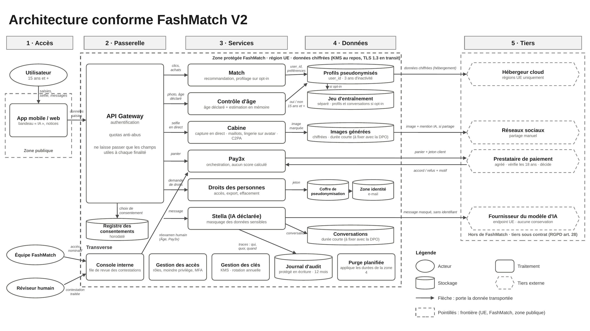

# Étape 4 — Architecture conforme FashMatch V2

Application mobile et web, sur le gabarit en cinq couches du kick-off : accès, passerelle, services, données, tiers. Même légende que la carte des flux.

*Source du schéma : [`annexes/schemas/source/architecture_v2.js`](annexes/schemas/source/architecture_v2.js), qui génère le fichier modifiable [`architecture_v2.pptx`](annexes/schemas/source/architecture_v2.pptx).*

## Les six règles du how-to

| Règle | Comment elle est appliquée |
|---|---|
| Une boîte, un composant | Pas de « backend » : API Gateway, six services nommés, sept stockages, cinq composants transverses, quatre tiers. |
| Des flèches qui parlent | Chaque flèche porte la donnée transportée (« panier + jeton client », « message masqué, sans identifiant », « oui / non 15 ans et + »…). |
| Des frontières visibles | Zone publique (app) ; zone protégée FashMatch en région UE ; hors de FashMatch (tiers sous contrat). |
| Les cinq couches | Accès, passerelle, services, données, tiers. |
| Le transverse dessiné | Console interne (file de revue), gestion des accès, gestion des clés, journal d'audit, purge planifiée, réviseur humain. |
| Ce qui est retiré disparaît | Insight n'apparaît nulle part. |

## Mesure → brique technique

| Mesure | Brique sur le schéma | Exigence |
|---|---|---|
| Chiffrement au repos | Gestion des clés (KMS), stockages chiffrés | EX-11, EX-12 |
| Chiffrement en transit | TLS 1.3 entre tous les composants (zone protégée) | EX-11 |
| Gestion des accès | Gestion des accès : rôles, moindre privilège, MFA | EX-09 |
| Journalisation | Journal d'audit protégé en écriture, 12 mois | EX-09 |
| Pseudonymisation | Profils pseudonymisés + coffre de pseudonymisation séparé de la zone identité | EX-03 |
| Purge | Purge planifiée, applique les durées de la couche données | EX-05, EX-08 |
| Marquage des contenus | Cabine (signature C2PA) + mention visible | EX-07 |
| Consentement | Registre des consentements horodaté | EX-06 |
| Supervision humaine | Console interne (file de revue) + réviseur humain | EX-17 |
| Localisation UE | Zone protégée en région UE ; hébergeur et fournisseur du modèle sur des serveurs UE | EX-13, EX-19 |

## Risques propres à l'IA (how-to, étape 4)

| Risque | Réponse dans l'architecture | Exigence |
|---|---|---|
| Injection de prompt | Stella : filtres d'entrée et de sortie, instructions cloisonnées | EX-16 |
| Fuite par le modèle | Stella n'envoie au fournisseur que le message masqué, sans identifiant | EX-19 |
| Données d'entraînement | Jeu d'entraînement séparé, alimenté sur opt-in, origine tracée | EX-06 |
| Sorties non contrôlées | Cabine : maillots et lingerie sur avatar uniquement, filtre sur les images produites | EX-24 |
| Abus du service | API Gateway : quotas anti-abus | Cahier des charges §5.1 (Abus) |
| Tiers opaque | Contrats art. 28 : endpoint UE, aucune conservation, pas d'entraînement | EX-19 |

## Rôles AI Act (repris de l'inventaire IA de la DPO)

| Système | Rôle de FashMatch |
|---|---|
| Match | Fournisseur et déployeur |
| Cabine | Fournisseur (art. 50.2) et déployeur (art. 50.4) |
| Stella | Fournisseur du système (art. 50.1) ; le modèle vient d'un tiers |
| Contrôle d'âge | Fournisseur et déployeur ; information des personnes (art. 50.3) |
| Pay3x | Plus de scoring : le prestataire agréé porte le système à haut risque |
