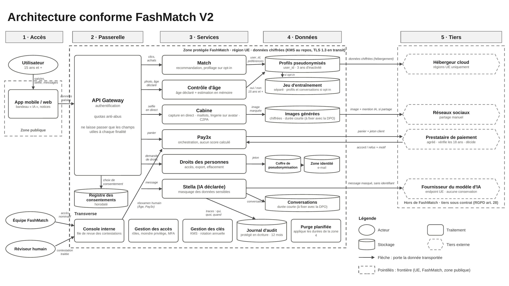
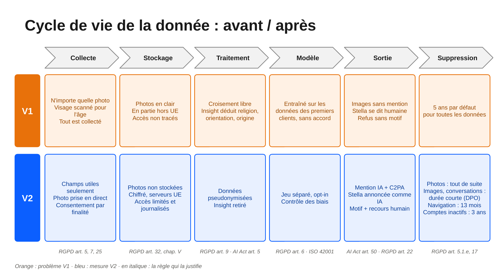

# L7 — Cahier des charges FashMatch V2

| Version | Date | Auteurs | Validé par (DPO) |
|---|---|---|---|
| 1.0 | 16/11/2026 | Kahina HINNI, Dorène (Data/IA) | Anta (DPO) |

## 1. Contexte et objectifs

FashMatch V1 est en accès anticipé depuis six mois. Elle présente des non-conformités graves
(une pratique interdite par l'AI Act, des décisions automatisées sans garanties, des photos en clair
hors UE) révélées par trois incidents publics. La direction exige trois promesses : recommandation
personnalisée, essayage virtuel différenciant, parcours d'achat fluide.

**Objectifs de la V2**

| ID | Objectif | Indicateur |
|---|---|---|
| O1 | Tenir les trois promesses produit | Match, Cabine et paiement fractionné disponibles en V2 |
| O2 | Être conforme au RGPD et aux obligations AI Act applicables au 13/11/2026 | 0 non-conformité bloquante à l'audit DPO |
| O3 | Être prête pour le 2/12/2026 (nudification, marquage) et le 2/12/2027 (haut risque) | Jalons de la feuille de route tenus |
| O4 | Pouvoir **prouver** la conformité | Chaque exigence tracée (§9) et vérifiable (§10) |

## 2. Périmètre

| Module | Décision | Périmètre V2 |
|---|---|---|
| Match | Encadrer | Recommandation sur achats + préférences ; navigation avec consentement ; interrupteur de personnalisation |
| Cabine | Encadrer (transformé) | Capture en direct uniquement ; maillots et lingerie essayés sur un avatar, jamais sur la vraie photo ; marquage ; photo traitée en mémoire, jamais stockée |
| Stella | Encadrer | Assistant identifié comme IA, ancré sur le catalogue, sans rétention longue |
| Âge | Encadrer | Estimation traitée en mémoire, seul un oui / non « 15 ans et + » conservé, jamais décisive seule (croisée avec l'âge déclaré) ; écart → tiers de confiance + recours humain ; 18 ans pour Pay3x vérifiés par le prestataire |
| Pay3x | Encadrer (délégué) | Orchestration du parcours ; décision prise par un partenaire agréé |
| Insight | Retirer | Remplacé par une segmentation déclarative agrégée |

**Hors périmètre** : développement de l'application V2 (seul le PoC pipeline est livré), choix commercial
du partenaire BNPL, refonte du catalogue.

## 3. Acteurs et parcours

| Acteur | Description |
|---|---|
| Client | 15 ans et plus ; 18 ans et plus pour Pay3x |
| Personne tierce | Non cliente ; ne doit jamais pouvoir être traitée par Cabine |
| Équipe FashMatch | Six personnes ; accès par rôle (dev, data, support, admin) |
| Réviseur humain | Membre du support formé ; traite contestations et signalements |
| DPO / référent IA | Valide les exigences, pilote les AIPD et la veille |
| Partenaire BNPL | Établissement agréé, décide de l'octroi du paiement fractionné |
| Fournisseur GPAI | Sous-traitant fournissant le modèle de Stella |

**Parcours P1 — Inscription** : saisie email + année de naissance + préférences (champs obligatoires
minimaux) → contrôle de cohérence → écran de consentements granulaires (personnalisation navigation,
amélioration des modèles, newsletters), tous décochés par défaut → compte créé.

**Parcours P2 — Essayage** : choix d'une tenue → notice Cabine (une fois) → capture caméra
en direct + liveness (pour maillots, lingerie et nuit : choix d'un avatar à la place de la photo) → génération → image affichée avec mention « Générée par IA » → sauvegarde ou
partage sur action explicite.

**Parcours P3 — Conseil** : ouverture de Stella (bandeau « Stella est une IA ») → conversation →
suggestions issues du catalogue → bouton « Parler à un conseiller ».

**Parcours P4 — Paiement fractionné** : panier → choix 3x/4x → redirection vers le partenaire
(vérification d'identité, décision) → accord, ou refus **avec motif** et lien « Demander un réexamen ».

**Parcours P5 — Droits** : espace « Mes données » → télécharger, corriger, supprimer, s'opposer
au profilage, retirer un consentement (aussi simple que l'avoir donné).

## 4. Exigences fonctionnelles

| ID | Module | Exigence |
|---|---|---|
| EF-01 | Âge (inscription) | Le formulaire d'inscription ne demande que : email, année de naissance, taille, préférences de style. |
| EF-02 | Âge (inscription) | Une année de naissance donnant moins de 15 ans bloque l'inscription avec un message explicatif et un contact. |
| EF-03 | Consentements | Les consentements sont granulaires, décochés par défaut, horodatés, versionnés et retirables depuis le profil. |
| EF-04 | Match | Un interrupteur « Recommandations personnalisées » désactive le profilage ; l'utilisateur reçoit alors des recommandations non personnalisées. |
| EF-05 | Match | Aucune publicité ciblée n'est proposée aux 15-17 ans. |
| EF-06 | Cabine | L'image source ne peut provenir que de la caméra, en direct, après détection du vivant ; l'import de galerie est impossible. |
| EF-07 | Cabine | Les catégories maillot, lingerie, sous-vêtements et nuit s'essaient uniquement sur un avatar (silhouette générée, choisie par l'utilisateur) : la photo de la personne n'est jamais utilisée pour ces catégories. |
| EF-08 | Cabine | Toute image générée porte une mention visible incrustée et des métadonnées C2PA. |
| EF-09 | Cabine | Le partage est désactivé par défaut ; un bouton « Signaler une image » est accessible publiquement. |
| EF-10 | Stella | Un bandeau permanent indique « Stella est une IA » ; l'avatar n'est pas photoréaliste. |
| EF-11 | Stella | Stella ne recommande que des produits existants du catalogue et renvoie vers les CGV pour prix, retours et garanties. |
| EF-12 | Stella | Un bouton permet de basculer vers un conseiller humain. |
| EF-13 | Pay3x | FashMatch transmet au partenaire uniquement le panier et un jeton client. |
| EF-14 | Pay3x | Un refus affiche le motif principal transmis par le partenaire et un lien de réexamen humain. |
| EF-15 | Droits | L'espace « Mes données » permet accès, export, rectification, effacement et opposition, traités sous un mois (RGPD art. 12.3). |
| EF-16 | Segmentation | Les segments marketing sont construits sur préférences déclarées et achats, jamais sur des images, avec au moins 50 personnes par segment. |

## 5. Exigences non fonctionnelles

### 5.1 Sécurité

| Mécanisme | Exigence | Brique technique |
|---|---|---|
| Chiffrement au repos | Toutes les bases et buckets chiffrés ; clés gérées par FashMatch, rotation annuelle | KMS du cloud (région UE), clés CMK |
| Chiffrement en transit | HTTPS partout, TLS 1.3 entre services, HSTS | Certificats gérés, mTLS interne |
| Gestion des accès | Rôles (dev, data, support, admin, DPO) ; moindre privilège ; aucun accès direct aux photos ; MFA obligatoire | IAM, SSO + MFA, accès temporaire « break glass » journalisé |
| Journalisation | Toute lecture/écriture de données personnelles et toute action console est journalisée (qui, quoi, quand, pourquoi) ; journaux non modifiables 12 mois ; sans contenu personnel en clair | Journal d'audit protégé en écriture, chaînage de hash (démontré dans le PoC), alertes |
| Pseudonymisation | La zone analytique ne contient aucun identifiant direct ; jeton HMAC-SHA256 ; coffre de correspondance séparé | Démontré dans le PoC |
| Sécurité applicative | OWASP ASVS niveau 2 ; OWASP Top 10 LLM pour Stella (injection, fuite, sorties) ; tests d'intrusion annuels | SAST/DAST en CI, red team LLM trimestrielle |
| Abus | Quotas de génération Cabine par compte et par jour ; détection d'automatisation | Rate limiting à la passerelle |
| Incidents | Procédure de violation de données (72 h) et de signalement de contenus | Runbook DPO + support |

### 5.2 Accessibilité

| ID | Exigence |
|---|---|
| ACC-01 | Application et site conformes RGAA 4.1 / WCAG 2.1 niveau AA ; déclaration d'accessibilité publiée. |
| ACC-02 | Cabine propose une alternative non visuelle : description textuelle de la tenue et des coupes, compatible lecteur d'écran. |
| ACC-03 | Stella est utilisable au clavier et au lecteur d'écran ; saisie vocale possible. |
| ACC-04 | Les mentions légales (IA, consentements, refus Pay3x) sont rédigées en langage clair et lisibles par les technologies d'assistance. |
| ACC-05 | Contrastes ≥ 4,5:1, zoom 200 % sans perte, pas d'information portée par la seule couleur. |

### 5.3 Performance

| ID | Exigence |
|---|---|
| PERF-01 | Recommandations Match affichées en moins de 500 ms (p95). |
| PERF-02 | Image Cabine générée en moins de 10 s (p95), filtres compris. |
| PERF-03 | Première réponse de Stella en moins de 3 s (p95). |
| PERF-04 | La purge quotidienne traite l'ensemble des données expirées en moins d'1 h. |

### 5.4 Conformité et gouvernance

| ID | Exigence |
|---|---|
| CONF-01 | Un DPO est désigné et déclaré à la CNIL ; un référent IA est nommé. |
| CONF-02 | Registre des traitements (L4) et inventaire des systèmes d'IA (L5) tenus à jour à chaque mise en production. |
| CONF-03 | AIPD réalisées avant mise en production pour Cabine, Stella et Pay3x. |
| CONF-04 | Contrats art. 28 signés avec hébergeur, fournisseur GPAI ; accord avec le partenaire BNPL précisant les rôles. |
| CONF-05 | Plan de formation « maîtrise de l'IA » pour les six membres de l'équipe. |
| CONF-06 | Toute communication publique sur la conformité est validée par le DPO. |

## 6. Architecture

L'architecture V2 suit le gabarit en cinq couches (accès, passerelle, services, données, tiers), avec le transverse dessiné : journalisation, gestion des accès, gestion des clés, purge et supervision humaine. Chaque flèche porte la donnée transportée ; Insight, retiré, n'y figure plus. Détail et correspondance mesure → brique : [architecture.md](architecture.md).

Le cycle de vie de la donnée compare la V1 et la V2 sur les mêmes six étapes, chaque mesure avec sa source : [pipeline.md](pipeline.md).

## 7. Contraintes

| Type | Contrainte |
|---|---|
| Équipe | Six personnes : on privilégie la suppression de fonctionnalités et les services managés aux développements maison (raison du choix de déléguer Pay3x). |
| Fournisseurs | Le fournisseur GPAI doit offrir un endpoint UE et un engagement contractuel de non-rétention ; à défaut, changer de fournisseur. |
| Données existantes | Les données V1 sans base légale (photos réutilisées, conversations, attributs Insight) sont supprimées, pas migrées. Les modèles entraînés dessus sont réentraînés. |
| Calendrier | 2/12/2026 : nudification et fin du délai de grâce du marquage. 2/12/2027 : haut risque annexe III. |
| Durées de conservation | Les durées courtes (images générées, tenues choisies, conversations) sont fixées avec la DPO et notées [durée] dans ce document : elles ne sont pas inventées par l'équipe Data/IA. |
| Budget | Coûts nouveaux principaux : vérification d'identité (portée par le partenaire BNPL), audit RGAA, tests d'intrusion. |

## 8. Feuille de route de conformité 2026-2027

| Période | Action | Exigences | Déclencheur réglementaire |
|---|---|---|---|
| **Semaine 0** (dès validation) | Arrêt d'Insight et suppression des attributs ; désactivation de l'import photo Cabine ; bandeau « Stella est une IA » ; estimation d'âge en mémoire + recours humain ; blocage Pay3x aux moins de 18 ans | EX-20, EX-14, EX-15, EX-04, EX-18 | AI Act art. 5.1.g (depuis 02/2025) ; art. 50.1 (depuis 08/2026, **déjà en retard**) |
| **Avant le 2/12/2026** | Avatars pour maillots et lingerie + filtre NSFW ; marquage C2PA + mention visible ; chiffrement des photos et rapatriement UE ; désignation du DPO | EX-24, EX-07, EX-11, EX-13, EX-25 | Omnibus 2026/1744 (nudification) ; art. 50.2 |
| **T1 2027** | AIPD Cabine / Stella / Pay3x ; registre ; consentements ; purge automatique ; journalisation ; contrat GPAI ; contrat partenaire BNPL ; audit RGAA | EX-05, EX-06, EX-09, EX-19, EX-17, EX-22, EX-25 | RGPD art. 5, 30, 32, 35 |
| **T2 2027** | Segmentation déclarative ; espace « Mes données » ; red team Stella et Cabine ; fiche modèle Match et rapport de biais en continu | EX-16, EX-21, EX-23, EX-10 | RGPD art. 12-22 ; ISO 42001 |
| **T3 2027** | Analyse d'écart ISO 27701 et ISO 42001 ; revue de direction | EX-25 | Bonnes pratiques |
| **Avant le 2/12/2027** | Vérifier la conformité haut risque du partenaire BNPL ; confirmer que FashMatch n'est ni fournisseur ni déployeur d'un système à haut risque | EX-18 | AI Act annexe III 5.b |
| **Août 2028** | Non concerné (annexe I) — revue de veille | – | AI Act art. 113 modifié |

## 9. Matrice de traçabilité

| N° | Exigence | Mesure | Source | Module | Vérification |
|---|---|---|---|---|---|
| EX-01 | Seuls les champs nécessaires à la finalité sont collectés et traités | Liste blanche par finalité à la passerelle et dans le pipeline | RGPD art. 5.1.c, 25 | Tous | PoC `minimise` + test |
| EX-02 | Aucune donnée réelle dans les environnements de test | Données synthétiques générées | RGPD art. 5.1.b, 32 | Tous | PoC `generate` |
| EX-03 | La zone analytique ne contient aucun identifiant direct | Pseudonymisation HMAC-SHA256, coffre séparé | RGPD art. 4.5, 25, 32 | Match | Test `aucun_identifiant_direct` |
| EX-04 | Aucun utilisateur de moins de 15 ans ; Pay3x réservé aux majeurs | Âge déclaré + cohérence ; KYC partenaire | RGPD art. 8 ; loi I&L art. 45 ; C. civ. art. 1146 | Âge, Pay3x | Tests `aucun_mineur`, `pay3x_majeurs` |
| EX-05 | Les données ne sont pas conservées au-delà des durées fixées avec la DPO | Purge automatique planifiée ; images générées, tenues et conversations : purge après [durée] | RGPD art. 5.1.e ; référentiel CNIL | Tous | Test `purge` |
| EX-06 | Personnalisation et entraînement reposent sur des consentements distincts | Tables séparées par consentement ; registre horodaté | RGPD art. 6.1.a, 7 | Match, Cabine, Stella | Test `entrainement_uniquement_consentants` |
| EX-07 | Les images générées sont identifiables comme telles | Mention visible + métadonnées C2PA | AI Act art. 50.2, 50.4 | Cabine | Contrôle C2PA sur échantillon |
| EX-08 | Les photos sources (Cabine, Âge) ne sont jamais stockées | Traitement en mémoire, aucune écriture disque | RGPD art. 5.1.e | Cabine | Revue de code + inventaire du stockage |
| EX-09 | Chaque traitement est tracé et le journal est infalsifiable | Journal chaîné, WORM, 12 mois | RGPD art. 5.2, 32 ; ISO 27701 | Tous | Test `journal_falsifie_detecte` |
| EX-10 | La qualité et les biais des données sont mesurés avant entraînement | Rapport qualité versionné | AI Act art. 10 (bonne pratique) ; ISO 42001 | Match | `annexes/poc/reports/rapport_qualite.md` |
| EX-11 | Les données sont chiffrées au repos et en transit | KMS, TLS 1.3 | RGPD art. 32 | Tous | Revue de configuration |
| EX-12 | Les clés sont gérées par FashMatch, hors du code | KMS, variable d'environnement en PoC | RGPD art. 32 | Tous | Revue de code |
| EX-13 | Les données personnelles restent dans l'UE | Région UE ; endpoint GPAI UE | RGPD chap. V | Tous | Revue des contrats et régions |
| EX-14 | Cabine ne peut pas traiter la photo d'un tiers | Capture en direct + liveness | RGPD art. 6 ; AI Act art. 5 (Omnibus) | Cabine | Test fonctionnel import refusé |
| EX-15 | Les utilisateurs savent qu'ils parlent à une IA | Bandeau permanent, avatar non humain | AI Act art. 50.1 | Stella | Revue UX |
| EX-16 | Stella résiste à l'injection de prompt | Cloisonnement, filtres entrée/sortie | RGPD art. 32 ; OWASP LLM01 | Stella | Red team trimestrielle |
| EX-17 | Toute décision automatisée défavorable est motivée et contestable | Motif + réexamen humain | RGPD art. 13-15, 22.3 ; dir. 2023/2225 | Pay3x | Test de parcours P4 |
| EX-18 | FashMatch ne calcule pas de score de solvabilité | Délégation au partenaire agréé | AI Act annexe III 5.b | Pay3x | Revue d'architecture |
| EX-19 | Le fournisseur GPAI ne conserve ni n'entraîne sur les conversations | Contrat art. 28, masquage avant envoi | RGPD art. 28, 32 | Stella | Contrat signé |
| EX-20 | Aucune catégorie particulière n'est inférée | Retrait d'Insight, purge des attributs | AI Act art. 5.1.g ; RGPD art. 9 | Insight | Absence du module et des données |
| EX-21 | Chaque modèle est documenté | Fiche modèle (données, métriques, limites) | ISO 42001 | Match, Cabine | Revue référent IA |
| EX-22 | L'application est accessible | RGAA 4.1 / WCAG 2.1 AA | Dir. (UE) 2019/882 ; RGAA | Tous | Audit RGAA |
| EX-23 | Les droits s'exercent simplement | Espace « Mes données », réponse sous un mois | RGPD art. 12-21 | Tous | Test de parcours P5 |
| EX-24 | Cabine ne produit pas d'image dénudée ou sexualisée | Maillots et lingerie sur avatar uniquement + filtre NSFW en sortie | Omnibus 2026/1744 ; C. pén. art. 226-8-1 | Cabine | Jeu de tests adverses |
| EX-25 | La conformité est pilotée | DPO, AIPD, registre, ISO 27701 / 42001 | RGPD art. 30, 35, 37 ; AI Act art. 4 | Tous | Revue de direction |

## 10. Critères de recette

Une exigence est réputée satisfaite lorsque sa colonne « Vérification » est passée avec succès et
archivée dans le dépôt. Les exigences EX-01 à EX-06, EX-09 et EX-10 sont déjà vérifiées
automatiquement par le PoC : 8 tests sur 8 réussis avec le catalogue réel Kaggle
(procédure de lancement dans [`annexes/poc/README.md`](annexes/poc/README.md)).

Version PDF de ce cahier des charges : [`annexes/Cahier_des_charges_FashMatch_V2.pdf`](annexes/Cahier_des_charges_FashMatch_V2.pdf).
