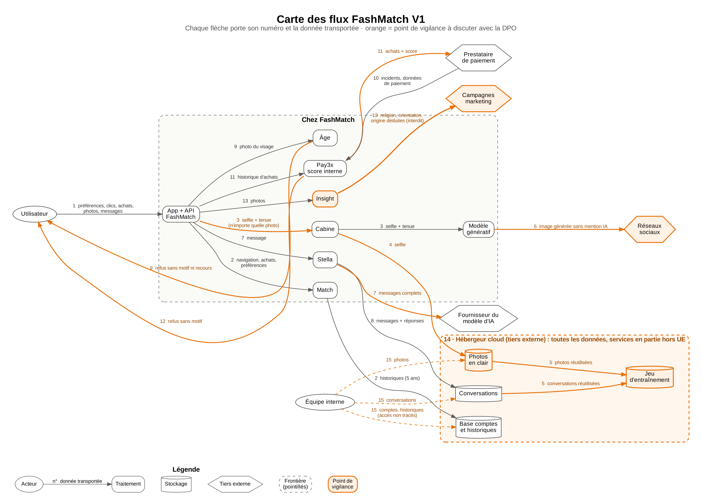

# Étape 2 — Carte des flux V1

Quatre symboles (acteur, traitement, stockage, tiers externe), une légende commune à tous nos schémas, des flux numérotés. Chaque flèche porte le nom de la donnée qu'elle transporte. Les frontières sont tracées : ce qui est chez FashMatch, ce qui est chez l'hébergeur (en partie hors UE). En orange : les points de vigilance à discuter avec la DPO.

*Source du schéma : [`annexes/schemas/source/carte_flux_V1.dot`](annexes/schemas/source/carte_flux_V1.dot) et [`legende.dot`](annexes/schemas/source/legende.dot) (Graphviz).*

## Les 15 flux

Mêmes numéros que sur la carte et dans l'onglet Flux de l'inventaire. Tous les tiers y sont : hébergeur (14), fournisseur du modèle de Stella (7), prestataire de paiement (10, 11), réseaux sociaux (6).

| N° | Flux | Données | Problème V1 | Ce qu'on fait en V2 |
|---|---|---|---|---|
| 1 | Utilisateur > App > API | Préférences, clics, achats, photos, messages | Tout est collecté | On limite aux champs utiles |
| 2 | API > Match > base | Navigation, achats, préférences | Gardé 5 ans | 13 mois pour la navigation, pseudonymisation |
| 3 | API > Cabine > modèle génératif | Selfie + tenue choisie | N'importe quelle photo (même d'une autre personne) | Photo prise en direct avec la caméra seulement |
| 4 | Cabine > stockage photos | Selfie | En clair, en partie hors UE | Plus de stockage |
| 5 | Stockage > entraînement | Photos, conversations, historiques | Réutilisé sans accord | Entraînement seulement si opt-in |
| 6 | Cabine > réseaux sociaux | Image générée | Aucune mention IA | Mention Générée par IA + marquage C2PA |
| 7 | Stella > fournisseur IA | Messages | On ne sait pas où ni combien de temps | Serveurs UE, pas de conservation, contrat |
| 8 | Stella > stockage conversations | Messages + réponses | Gardées 5 ans pour améliorer le service | Durée courte (à fixer avec Anta), réutilisation si opt-in |
| 9 | API > Âge > utilisateur | Photo, âge estimé, refus | Refus sans recours, contourné par photo retouchée | Traitement en mémoire + recours humain |
| 10 | Prestataire paiement > Pay3x | Incidents, données de paiement | Réutilisées pour un score interne | On ne les reçoit plus |
| 11 | Pay3x > prestataire paiement | Achats, score | Décision automatique, mineure acceptée | Le prestataire décide et vérifie les 18 ans |
| 12 | Pay3x > utilisateur | Refus | Pas de motif | Motif + demande de réexamen |
| 13 | API > Insight > campagnes | Photos, données déduites, segments | Interdit (AI Act art. 5.1.g) | Module retiré, données supprimées |
| 14 | FashMatch > hébergeur cloud | Toutes les données | Une partie hors UE | Hébergement UE uniquement |
| 15 | Équipe interne > bases / photos | Toutes les données | Accès pas tracés | Accès par rôle + journal |
