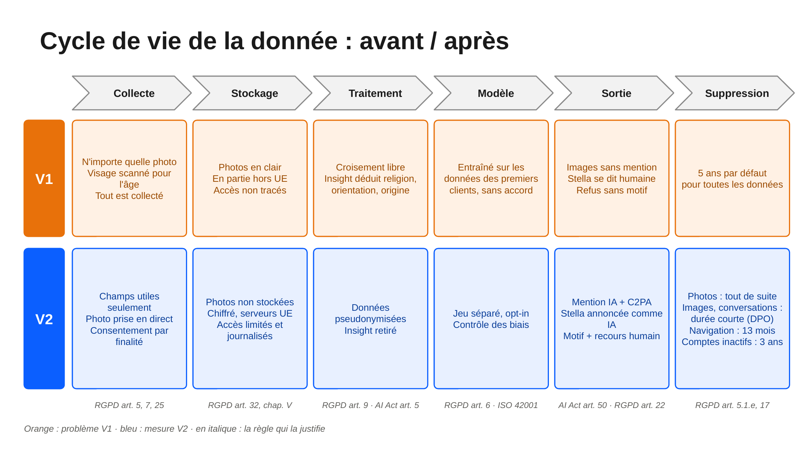
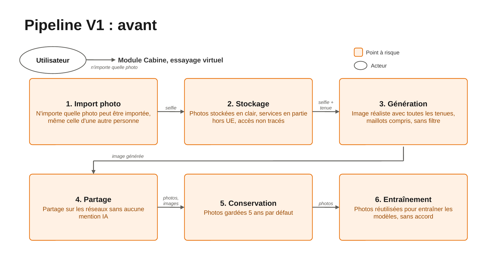
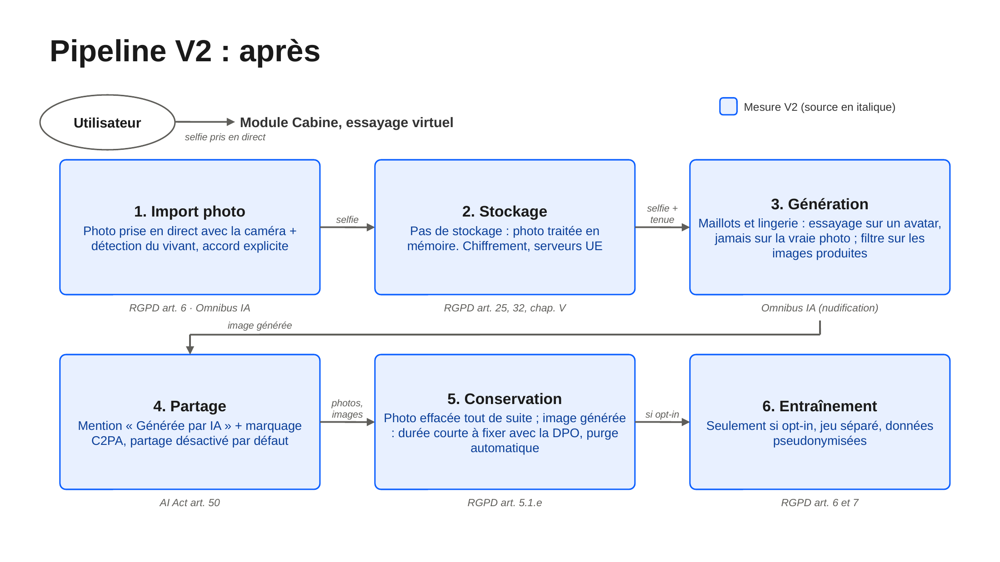

# Étape 3 — Pipeline avant / après

Les quatre règles du how-to sont appliquées :

- **mêmes étapes des deux côtés** : la V1 et la V2 ont le même squelette ;
- **une couleur par statut** : orange pour un problème en V1, bleu pour une mesure en V2, rien d'autre ;
- **une mesure = une source** : chaque mesure V2 renvoie à un article, une norme ou une recommandation ;
- **lisible par un DPO** : chaque case a été relue par Anta (à cocher dans la checklist du README).

## Cycle de vie de la donnée, tous modules

| Étape | V1 · problème | V2 · mesure | Source |
|---|---|---|---|
| Collecte | N'importe quelle photo, visage scanné pour l'âge, tout est collecté | Champs utiles seulement, photo prise en direct, consentement par finalité | RGPD art. 5, 7, 25 |
| Stockage | Photos en clair, en partie hors UE, accès non tracés | Photos non stockées ; données chiffrées en région UE ; accès par rôle et journalisés | RGPD art. 32 (sécurité), chapitre V (transferts) |
| Traitement | Croisement libre ; Insight déduit religion, orientation, origine | Données pseudonymisées ; module Insight retiré | RGPD art. 9 ; AI Act art. 5.1.g |
| Modèle | Entraîné sur les données des premiers clients, sans accord | Jeu d'entraînement séparé, opt-in ; contrôle des biais | RGPD art. 6 ; ISO/IEC 42001 |
| Sortie | Images sans mention, Stella se dit humaine, refus sans motif | Mention « Générée par IA » + C2PA ; Stella annoncée comme IA ; motif + recours humain | AI Act art. 50 ; RGPD art. 22 |
| Suppression | 5 ans par défaut pour toutes les données | Photos effacées tout de suite ; images et conversations : durée courte **[à fixer avec la DPO]** ; navigation 13 mois ; comptes inactifs 3 ans | RGPD art. 5.1.e, 17 ; référentiel CNIL |

## Zoom sur Cabine

| Étape | V1 · problème | V2 · mesure | Source |
|---|---|---|---|
| Import photo | N'importe quelle photo, même celle d'une autre personne | Photo prise en direct avec la caméra + détection du vivant, accord explicite | RGPD art. 6 ; Omnibus IA (interdiction de la nudification) |
| Stockage | Photos en clair, en partie hors UE, accès non tracés | Pas de stockage : photo traitée en mémoire ; chiffrement, serveurs UE | RGPD art. 25, 32, chapitre V |
| Génération | Image réaliste avec toutes les tenues, maillots compris, sans filtre | Maillots et lingerie essayés sur un avatar, jamais sur la vraie photo ; filtre sur les images produites | Omnibus IA (nudification) |
| Partage | Partage sur les réseaux sans aucune mention IA | Mention visible « Générée par IA » + marquage C2PA, partage désactivé par défaut | AI Act art. 50 (transparence) |
| Conservation | Photos gardées 5 ans par défaut | Photo effacée tout de suite ; image générée : durée courte **[à fixer avec la DPO]**, purge automatique | RGPD art. 5 (limitation de la conservation) |
| Entraînement | Photos réutilisées pour entraîner les modèles, sans accord | Seulement si opt-in, jeu séparé, données pseudonymisées | RGPD art. 6 (base légale), art. 7 |

*Sources des schémas : [`annexes/schemas/source/pipeline_et_cycle_de_vie.js`](annexes/schemas/source/pipeline_et_cycle_de_vie.js) (génère les fichiers PowerPoint modifiables [`pipeline_cabine_avant_apres.pptx`](annexes/schemas/source/pipeline_cabine_avant_apres.pptx) et [`cycle_de_vie_avant_apres.pptx`](annexes/schemas/source/cycle_de_vie_avant_apres.pptx)).*
